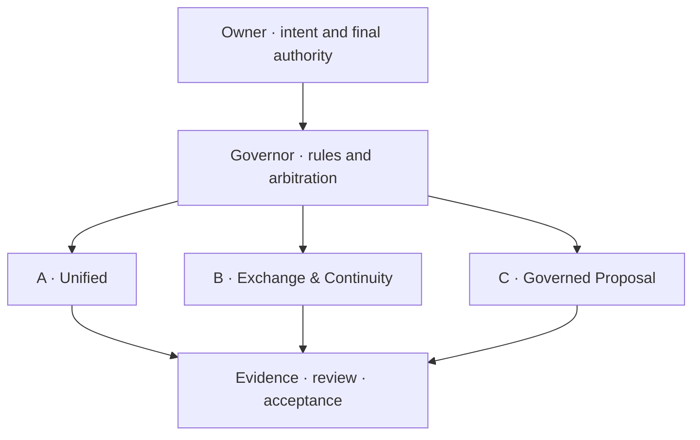
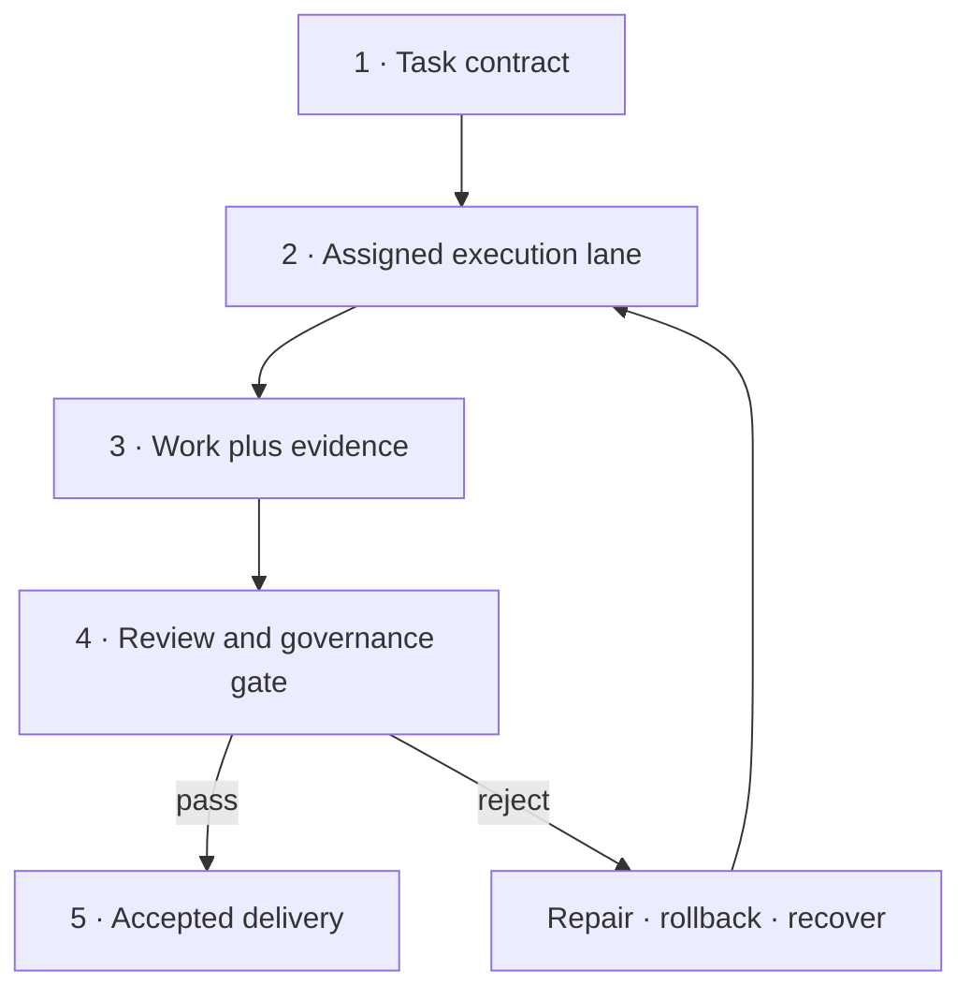

# ZeoStudio TenGate

<div align="center">

### Stop prompting agents to cooperate. Give them a system.

**Turn chaos into protocol. Turn forgotten context into memory. Turn “done” into evidence.**

[](https://github.com/Righteous1776/ZeoStudio-TenGate/releases/tag/v4.1.0)
[](LICENSE)


**English** · [简体中文](README_CN.md) · [Download V4.1.0](https://github.com/Righteous1776/ZeoStudio-TenGate/releases/tag/v4.1.0)

</div>

---

> [!IMPORTANT]
> **V4.1.0 is fully open source.** No key, answer, password, cloud decryption service, paid unlock, or staged encrypted archive is required. Download, inspect, modify, fork, and build directly under Apache-2.0.

## The age of AI Agents should not be governed by chat history

Most multi-agent systems begin with an impressive demo and end with the same questions:

| The usual failure | TenGate's answer |
|---|---|
| Who is actually allowed to decide? | Explicit Owner / Governor / Lane authority |
| What happens when a chat ends? | Persistent task contracts and structured handoffs |
| How do agents exchange work without creating noise? | Governed messages, proposals, and review gates |
| Can “I finished it” be trusted? | Evidence-backed delivery and machine-checkable acceptance |
| What survives across sessions? | Numbered M00–M09 memory spaces and reviewed consolidation |
| What happens when tools or platforms differ? | Capability detection, downgrade rules, and recovery paths |

**ZeoStudio TenGate is not a larger prompt. It is an operating discipline for agents that are expected to finish real work.**

> One foundation. Three architectures. A serious workflow.

## System at a glance



## Three architectures, one philosophy

| Architecture | Primary job | Best fit | What it protects |
|---|---|---|---|
| **A · Unified** | Put coordination, governance, memory, and persistent tasks behind one operating entrance | A single serious project with several cooperating agents | Shared direction, responsibility, and execution continuity |
| **B · Exchange & Continuity** | Standardize agent-to-agent exchange, task state, interruption, and resumption | Long-running work that crosses chats, models, or devices | Context, ownership, checkpoints, and handoff integrity |
| **C · Governed Proposal** | Isolate proposals from authority and require review before adoption | High-risk repositories, parallel agents, or controlled production | Permission boundaries, auditability, rollback, and final approval |

They are not three skins for the same prompt. They are three deployment shapes for the same governing idea:

> **Coordination is not a slogan. Governance is the foundation.**

## What is inside the Skills

TenGate packages the practices that usually remain scattered across chats, personal habits, and unwritten assumptions.

| Skill layer | Included capability | Practical result |
|---|---|---|
| **Authority model** | Owner, Governor, execution lanes, scoped permissions | Agents know who may decide, propose, execute, review, or stop |
| **Task contracts** | Objective, scope, owner, constraints, acceptance criteria, recovery state | A task remains identifiable even when the conversation disappears |
| **Persistent execution** | Checkpoints, resumable state, interruption handling, recovery rules | “Continue” means resuming a defined state, not guessing from the last message |
| **Agent exchange** | Structured messages, requests, responses, and handoff payloads | Parallel agents exchange useful state instead of producing chat noise |
| **Proposal governance** | Isolated proposals, review gates, approval boundaries | Suggestions cannot silently become policy or production changes |
| **Memory operations** | M00–M09 numbered memory spaces, staging, review, consolidation | Memory becomes an operated system instead of an unfiltered transcript |
| **Conflict control** | Ownership checks, collision handling, arbitration, rollback | Competing edits have a defined resolution path |
| **Evidence discipline** | Logs, artifacts, verification steps, acceptance records | “Done” can be inspected, reproduced, and rejected when unsupported |
| **Cross-session handoff** | Session summaries, task state transfer, next-action commands | A new agent can take over without rebuilding the entire project history |
| **Platform adaptation** | Capability detection and explicit degradation behavior | The workflow survives when a platform lacks tools, files, or automation |
| **Release discipline** | Public source, SHA-256 manifest, reproducible checks | Users can inspect every file and verify the issued archive | 

## From intent to verified delivery



| Stage | Required question | Proof expected |
|---|---|---|
| Contract | What exactly must be achieved? | Scope, owner, constraints, acceptance criteria |
| Execution | Who is changing what? | Lane ownership and checkpointed work |
| Evidence | What demonstrates completion? | Tests, diffs, artifacts, logs, or reproducible checks |
| Review | Is the result permitted and correct? | Gate decision with reasons |
| Recovery | What happens after interruption or failure? | Resume point, rollback path, and next command |

## Memory that can be governed

TenGate uses **M00–M09 numbered memory spaces** as reviewable operational memory—not as a raw dump of everything an agent has ever said.

| Operation | Purpose |
|---|---|
| Capture | Preserve facts, decisions, constraints, and unresolved work |
| Stage | Keep unverified material separate from trusted memory |
| Review | Check provenance, relevance, conflicts, and sensitivity |
| Consolidate | Convert approved material into durable project memory |
| Handoff | Transfer only the state needed for the next agent or session |
| Correct | Update conclusions without erasing the evidence trail |

The exact memory schema and operating instructions are carried inside the official archive.

## Designed for work that outlives a chat

| Scenario | Without governance | With TenGate |
|---|---|---|
| Parallel coding agents | Duplicate edits and silent conflicts | Owned lanes, proposal isolation, review gates |
| Long-running research | Sources and decisions vanish between sessions | Evidence-backed memory and resumable task state |
| Repository management | Any agent can accidentally act like release manager | Explicit authority and controlled publishing |
| Cross-model migration | The new model improvises from a short summary | Structured takeover package and acceptance rules |
| Tool-limited platforms | Workflow quietly breaks | Declared capability downgrade and fallback behavior |
| Interrupted execution | “Continue” restarts the reasoning from scratch | Checkpoint, recovery state, and single next action |

## Full open-source V4.1.0 distribution

V4.1.0 publishes the complete A/B/C Foundation V1.5 source directly. The official asset is:

**`ZeoStudio-TenGate-Full-Source-V4.1.0.zip`**

| Verification item | Value |
|---|---|
| Product release | `v4.1.0` |
| Foundation bundle | `V1.5` |
| Python compile check | `45/45 PASS` |
| Test result | `222 passed · 2 intentionally skipped · 0 failed` |
| Archive SHA-256 | `71de300460a294b4616d0ab375d84736a65a7442640d751c14dd826582131732` |
| Encryption / password | **None** |
| License | **Apache-2.0** |

### Download and use

```bash
unzip ZeoStudio-TenGate-Full-Source-V4.1.0.zip
cd ZeoStudio-TenGate-Full-Source-V4.1.0

# Start with the unified architecture
less A_Zeo_Unified_Foundation/SKILL.md

# Preview installation in a clean test repository
python A_Zeo_Unified_Foundation/tools/install_unified.py \
  --target /path/to/clean-test-repo \
  --project-slug DEMO \
  --owner YOUR_NAME \
  --dry-run
```

### What “no lock” means

The old answer-gated reader and encrypted challenge are no longer the recommended distribution path. Lock/Lease, Study Gate, Owner/Governor/Lane authority, and Agent Inbox remain because they govern agent behavior inside a target project; they do **not** restrict access to this source code.

## Security and truthfulness

The public source bundle excludes credentials, signing private keys, runtime memory databases, personal conversations, private project source, and real user data. Synthetic secret strings inside memory tests exist only to verify that sensitive input is rejected. SHA-256 verifies file integrity; it does not replace independent review. Please read [SECURITY.md](SECURITY.md) before reporting a vulnerability.

## Contributing

Read [CONTRIBUTING.md](CONTRIBUTING.md) before opening an Issue or pull request. Contributions must preserve task ownership, review gates, rollback paths, evidence requirements, and the privacy boundary around non-public artifacts.

## License

Original ZeoStudio materials are released under the [Apache License 2.0](LICENSE). Third-party material remains subject to its own notices and attribution requirements.

---

<div align="center">

### The architecture behind agents that actually finish the job.

**Designed by ZeoStudio · 久野零**

**Coordinate with intent. Recover with evidence. Govern by design.**

</div>
