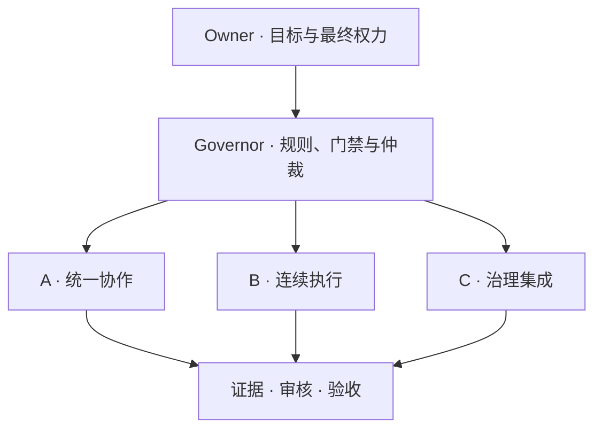
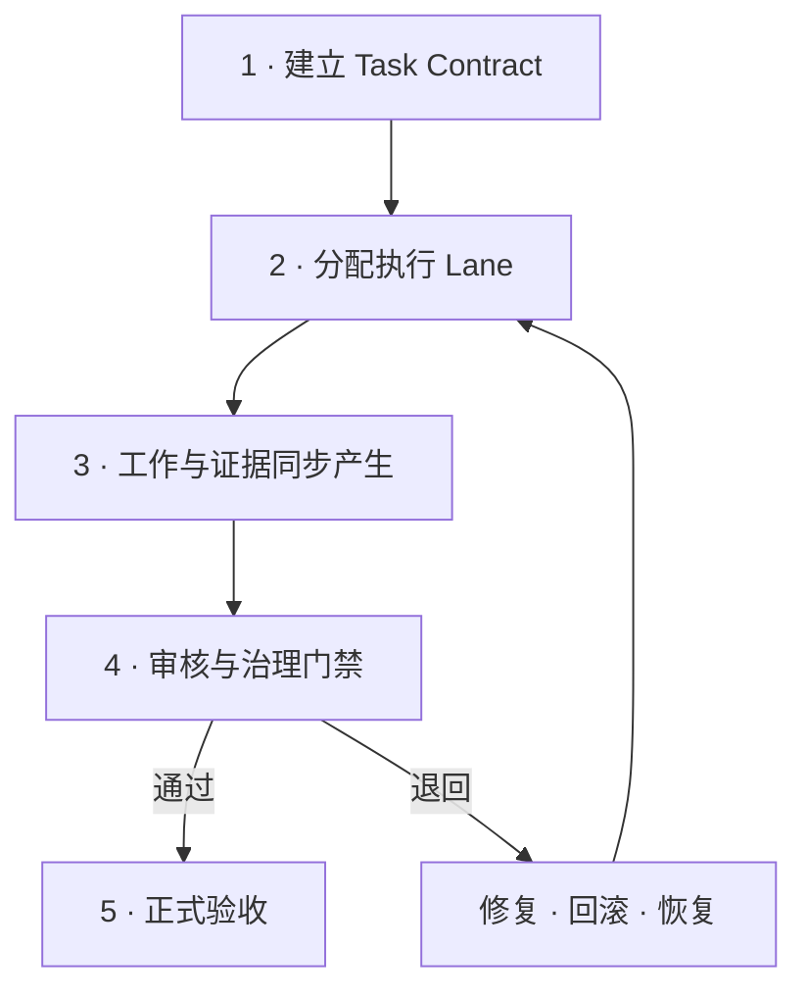

# ZeoStudio TenGate

<div align="center">

### 别再反复提醒 Agent 要合作。给它们一套真正的制度。

**把混乱变成制度。把遗忘变成记忆。把“我做完了”变成可以验证的证据。**

[](https://github.com/Righteous1776/ZeoStudio-TenGate/releases/tag/v4.0)
[](LICENSE)


[English](README.md) · **简体中文** · [下载 V4.0](https://github.com/Righteous1776/ZeoStudio-TenGate/releases/tag/v4.0)

</div>

---

## AI Agent 的时代，不该靠聊天记录维持秩序

把几个 AI 拉进同一个任务，并不等于协作。

真正的协作，必须回答这些问题：谁有权决定？谁负责执行？任务中断之后由谁接手？一个 Agent 说“完成了”，证据在哪里？结论改变之后，旧证据是否还存在？多个 Agent 同时改同一个项目时，谁来处理冲突？

ZeoStudio TenGate V4.0 试图把这些最容易失控的部分——**权限、任务、记忆、交接、提案、审核、证据与恢复**——变成一套可以部署、检查、继承和继续执行的工程制度。

| 多 Agent 常见失控点 | TenGate 给出的制度答案 |
|---|---|
| 每个 Agent 都像最终决策者 | Owner / Governor / Lane 权限分层 |
| 聊天结束，任务状态一起消失 | Task Contract 与任务持久化 |
| “我做完了”无法证明 | 证据、验证脚本与验收门禁 |
| Agent 之间只有自然语言转述 | 结构化消息、提案与交接载荷 |
| 记忆越积越多，真假混在一起 | M00–M09 编号记忆区与审核式归档 |
| 多个执行者相互覆盖 | 所有权检查、冲突仲裁与回滚路径 |
| 换模型、换平台就重新开始 | 跨会话接管与能力降级规范 |

> **ZeoStudio 不是一份更长的 Prompt。它是一套要求 Agent 对结果负责的运行制度。**

## 一张图看懂 TenGate



## 三套架构，一套思想

| 架构 | 核心任务 | 最适合什么场景 | 重点保护什么 |
|---|---|---|---|
| **A · Unified / 统一协作** | 把协作、治理、记忆与持续任务汇入统一入口 | 单个大型项目、多个 Agent 长期协作 | 统一方向、责任归属、执行连续性 |
| **B · Exchange & Continuity / 连续执行** | 规范 Agent 通信、任务状态、中断和恢复 | 跨聊天、跨模型、跨设备的长任务 | 上下文、检查点、接管质量、任务不失联 |
| **C · Governed Proposal / 治理集成** | 把“提出建议”与“获得执行权”严格分开 | 高风险仓库、并行开发、受控发布 | 权限边界、审核记录、回滚能力、最终批准权 |

它们不是同一份 Prompt 换了三个名字，而是同一套治理思想的三种工程形态。

> **协作不是口号，治理才是底座。**

## Skill 里到底有什么

TenGate 把过去散落在聊天记录、个人习惯和口头约定里的规则，压进了可迁移的 Skill 工作体系。

| Skill 能力层 | 包含内容 | 它解决的问题 |
|---|---|---|
| **权限治理** | Owner、Governor、执行 Lane、权限范围 | 谁能决定、谁能提案、谁能执行、谁能叫停 |
| **任务契约** | 目标、范围、负责人、限制条件、验收标准、恢复状态 | 聊天消失后，任务本身仍然存在 |
| **持续执行** | 检查点、断点续接、中断处理、恢复规则 | “继续”不再等于根据最后一句话重新猜 |
| **Agent 通信** | 结构化请求、回应、消息、交接载荷 | 多 Agent 交换有效状态，而不是制造更多对话噪声 |
| **提案治理** | 隔离提案、审核门禁、批准边界 | 建议不能悄悄变成制度或生产修改 |
| **记忆运营** | M00–M09 编号记忆区、暂存、审核、合并 | 记忆不再是未经筛选的聊天垃圾场 |
| **冲突控制** | 所有权检查、编辑碰撞处理、仲裁、回滚 | 多个 Agent 撞车时，有明确的处理顺序 |
| **证据纪律** | 日志、工件、验证步骤、验收记录 | “完成”必须能够被检查、复现，也可以被驳回 |
| **跨会话接管** | 会话摘要、任务状态转移、唯一下一步命令 | 新 Agent 不需要从头重建整个项目历史 |
| **平台适配** | 能力识别、工具缺失时的降级行为 | 换平台之后，制度不会悄悄失效 |
| **发行纪律** | 签名清单、完整性校验、受控分发 | 用户可以验证下载到的是否为正式发布工件 |

## 从一句目标，到可验证交付



| 阶段 | 必须回答的问题 | 必须留下的东西 |
|---|---|---|
| 任务契约 | 到底要完成什么？ | 范围、负责人、限制条件、验收标准 |
| 执行 | 谁正在修改什么？ | Lane 所有权与阶段检查点 |
| 证据 | 凭什么说已经完成？ | 测试、Diff、工件、日志或可复现检查 |
| 审核 | 结果正确吗？它有权被合并吗？ | 带理由的门禁结论 |
| 恢复 | 失败或中断之后怎么办？ | 恢复点、回滚路径与唯一下一步命令 |

## M00–M09：记忆不是仓库，记忆也需要治理

TenGate 使用 **M00–M09 编号记忆空间**组织长期状态。它的重点不是“什么都记住”，而是让事实、判断、证据、未完成事项和交接信息经过筛选后进入正确位置。

| 记忆动作 | 作用 |
|---|---|
| 捕获 Capture | 保存事实、决策、限制条件和未解决事项 |
| 暂存 Stage | 把未经验证的信息与可信记忆分开 |
| 审核 Review | 检查来源、相关性、冲突和敏感性 |
| 合并 Consolidate | 把通过审核的内容写入长期项目记忆 |
| 交接 Handoff | 只把下一位 Agent 真正需要的状态交出去 |
| 修正 Correct | 更新结论，同时保留证据与变更轨迹 |

具体的编号结构、字段与执行规范，以正式发行包中的 Skill 为准。

## 它适合什么

| 场景 | 没有治理时 | 使用 TenGate 后 |
|---|---|---|
| 多 Agent 并行写代码 | 重复修改、相互覆盖、无人负责 | Lane 所有权、隔离提案、统一审核 |
| 长周期研究 | 换聊天后来源和结论断裂 | 证据化记忆与可恢复任务状态 |
| GitHub 仓库管理 | 每个 Agent 都可能误当发布管理员 | 权限分层与受控发布 |
| 跨模型迁移 | 新模型只拿到一份含糊摘要 | 标准化接管包、硬门与验收规范 |
| 工具受限的平台 | 工具缺失后流程无声失效 | 明确降级、替代路径和阻塞上报 |
| 执行突然中断 | “继续”时从头推理 | 检查点、恢复状态与下一步执行令 |

## 正式发行：TenGate V4.0

V4.0 采用 **签名离线挑战归档** 形式发行。唯一官方产品附件是：

### [下载 ZeoStudio_PUBLIC_V4.0.zip](https://github.com/Righteous1776/ZeoStudio-TenGate/releases/download/v4.0/ZeoStudio_PUBLIC_V4.0.zip)

| 验证项 | 内容 |
|---|---|
| Release | `v4.0` |
| 产品包 SHA-256 | `a4831e700c30a19631e0d82f12be8169e903683558e6184a9589ea8a2e4b9c99` |
| 签名者指纹 | `3d6d821fea7656004a147873d6e79f4c6494eea18758200c924ef742297ce3c3` |
| 签名清单 | **PASS** |
| 阅读流程 | 下载后可离线执行，无需云端解密服务 |

### 第一步：验证发行包

把公共包解压到干净目录，然后运行：

```bash
python -m pip install -r requirements.txt
python VERIFY_RELEASE.py --directory . \
  --pinned-fingerprint 3d6d821fea7656004a147873d6e79f4c6494eea18758200c924ef742297ce3c3
```

验证成功后，使用随包提供的读取器检查并逐步推进：

```bash
python reader.py inspect ZeoStudio_Archive_V4.0.zip
python reader.py open-one ZeoStudio_Archive_V4.0.zip \
  --answer "<computed_answer>" \
  --output next.zip \
  --checkpoint local.progress.json
```

## 安全边界与真实声明

数字签名与认证加密用于保护发行工件的真实性和完整性，但它们不代表独立密码学审计，不保证任何人都无法分析，也不保证所有硬件具有相同运行时间，更不声称必须消耗固定数量的 Token。

提交安全问题前，请阅读 [SECURITY.md](SECURITY.md)。不要在公开 Issue 中上传账号凭证、私人恢复材料、私人解密结果或个人数据。

## 参与贡献

提交 Issue 或 Pull Request 前，请阅读 [CONTRIBUTING.md](CONTRIBUTING.md)。所有贡献都必须保留任务所有权、审核门禁、证据要求、回滚路径和非公开材料边界。

## 开源许可

ZeoStudio 原创材料采用 [Apache License 2.0](LICENSE) 发布。第三方材料如存在单独许可或署名要求，以对应声明为准。

---

<div align="center">

## 如果 AI 真正开始协作，它们应该遵守什么制度？

今天，**ZeoStudio TenGate V4.0** 正式完成构建。

三套架构，一套思想。

**A：统一协作。B：连续执行。C：治理集成。**

从任务持久化到 Agent 治理，从编号记忆库到跨会话接管——我们不想再靠一句“请认真完成任务”维持秩序。

**ZeoStudio · 久野零**

### 协作不是口号，治理才是底座。

</div>
